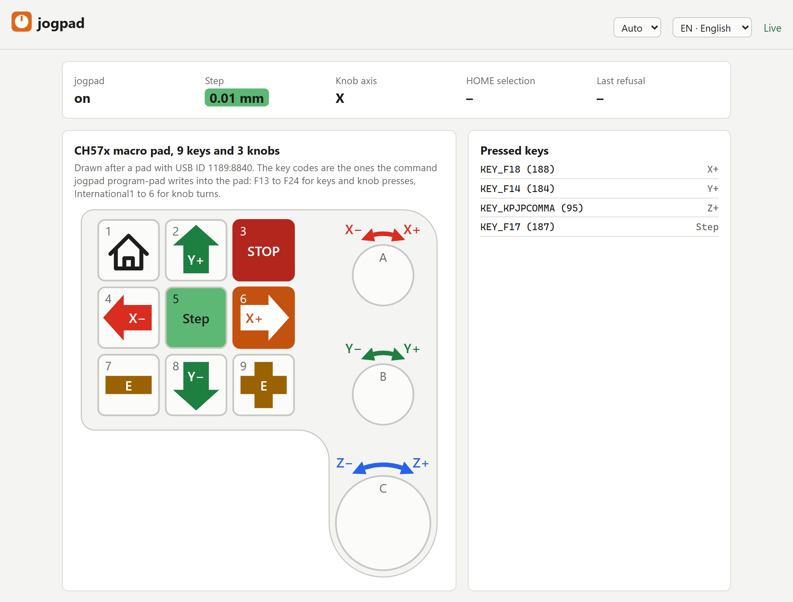

<p align="center">
  <picture>
    <source media="(prefers-color-scheme: dark)" srcset="docs/assets/logo-dark.svg">
    
  </picture>
</p>

<p align="center">
  <b>Jog your 3D printer or CNC machine with keys and knobs you can feel,<br>
  not with a touchscreen.</b>
</p>

<p align="center">
  <a href="https://github.com/Aitch-ko/jogpad/actions/workflows/ci.yml"></a>
  <a href="LICENSE"></a>
  
  
</p>

<p align="center">
  
</p>

## Sound familiar?

You are levelling the bed with a sheet of paper. Eyes on the touchscreen,
finger on Z−. Eyes back on the nozzle, tap again. Blind, because you are
watching the paper. The finger has slipped to the next button, the nozzle
moves 10 mm instead of 0.1, or the wrong way, and digs into the bed.

A touchscreen has nothing to feel. You cannot find a button without looking
at it, and you cannot look at the nozzle and the screen at once.

The mouse is no better when the printer does not stand right next to the
monitor. Look away to the nozzle, click, and you do not know where the
pointer is any more.

**jogpad** turns a numeric keypad or a small macro pad with knobs into a jog
pendant for [Klipper](https://www.klipper3d.org/). Every key sits where your
finger left it. One press or one knob detent is one step. Your eyes stay on
the nozzle.

- **Jog X, Y, Z and the extruder** in steps of 0.01, 0.1 or 1 mm, switched with
  one key. Presses that pile up during a move are merged, so the axis stops
  when you stop. Hold a key, and the axis keeps moving until you let go, at a
  speed that goes with the step size.
- **Home** all axes or just the ones you pick, and **stop** with one key.
- **Any USB keyboard works**, from a cheap numeric keypad to a macro pad
  with knobs, see [which pad](#which-pad).
- **A web page** draws your pad, lights up every key you press, learns new
  keys and checks that each axis moves the way you expect.
- **Visible to everyone at the machine**: every move appears in the Mainsail
  or Fluidd console.
- **Refuses to move during a print**, and you can add your own locks.
- **Switch it off in Mainsail or Fluidd** when you do not need it; then no key
  does anything.
- **Installs next to Klipper** as a service with one script, and shows up in
  the service menu of Mainsail and Fluidd.

<p align="center">
  <picture>
    <source media="(prefers-color-scheme: dark)" srcset="docs/assets/screenshots/web-page-dark.png">
    
  </picture>
</p>

Useful for bed levelling, setting the Z offset, probing and measuring,
positioning by eye and loading filament. Mills, lasers, plasma cutters and
metal deposition machines have the same problem; [use cases](docs/use-cases.md)
tells which of them jogpad covers today and which are planned.

> [!WARNING]
> The STOP key is not an emergency stop. It goes through USB, the host and the
> network. Keep a wired emergency stop on your machine. See [Safety](docs/safety.md).

## Which pad

- **A small USB numeric keypad.** It costs a few euros and works as it
  comes: plug it in, enter it in `jogpad.toml`, done.
- **An old keyboard** from the drawer: its numeric block works the same way.
  Wireless keyboards work too, but take one with a cable if you can. A key
  release lost over radio keeps a held key's axis moving until you press
  another key, see [Safety](docs/safety.md#wireless-pads).
- **A macro pad with 9 keys and 3 knobs (recommended).** The knobs turn like
  handwheels, the big one for Z, and the pad lights up in the colour of the
  step size. It is sold under many names. jogpad is tested with one that
  shows up with USB ID 1189:8840 (`lsusb` shows it), and `jogpad program-pad`
  sets it up without the vendor's software. Pads with 1189:8890 speak another
  protocol and do not work yet.

## Status

Early development. Working today, on Linux with Klipper:

- jog, home and stop from a numeric keypad or any USB keyboard; tested on a
  QIDI Plus 4 with the keypad of a Logitech MX Keys S
- a held axis key keeps moving until released, at a speed set with the step
  key, at most 250 mm/s
- every move and homing shows up in the Mainsail or Fluidd console
- a web page in English and German, light or dark, that draws the pad with
  arrows and signs in the colour of each axis on its keys and over its knobs,
  shows each key press live and the step size from green to red, learns keys
  and checks the direction of each axis; reachable from every computer in the
  network, changes only from those Moonraker trusts
- a switch in Mainsail and Fluidd that turns jogpad off, STOP included
- the pad and its state as a camera panel in Mainsail and Fluidd, sized to
  the pad and with a link to the full page
- an installer that sets jogpad up as a service next to Klipper
  ([installation](docs/installation.md), [setup](docs/usage.md))
- `jogpad program-pad` writes its key codes into a CH57x macro pad with 9 keys
  and 3 knobs (USB ID 1189:8840), without the vendor's software, and reads them
  back to check; then its knobs move X, Y and Z and its keys form a cross for X
  and Y, with no key setup, and the pad lights up in the colour of the step size;
  tested on the QIDI Plus 4, held keys included

| | Now | Later |
| --- | --- | --- |
| Firmware | Klipper (Moonraker) | RepRapFirmware, FluidNC |
| Operating system | Linux | Windows, macOS |
| Pads | numeric keypads, any USB keyboard, CH57x macro pad 1189:8840 programmed by jogpad | other CH57x macro pads |

## Getting started

On the computer that runs Klipper, as the user that runs Klipper:

```bash
cd ~
git clone https://github.com/Aitch-ko/jogpad.git
./jogpad/scripts/install.sh
```

Then enter your pad in `~/printer_data/config/jogpad.toml`, see
[Klipper setup](docs/usage.md).

Then open, with your printer's name or address:

- `http://printer.local:7150/` for the web page
- `http://printer.local:7150/docs` for the Swagger UI of the API

Every computer in your network can watch; only the computers Moonraker trusts
may change settings, see
[who may change what](docs/usage.md#who-may-change-what).

## Documentation

The documentation is online at <https://aitch-ko.github.io/jogpad/>. Its
source lives in [`docs/`](docs/) and is built with
[Zensical](https://zensical.org/).

| Page | What |
| --- | --- |
| [Installation](docs/installation.md) | installer, updates, development setup |
| [Klipper setup](docs/usage.md) | find the pad, write `jogpad.toml`, keys, web page |
| [Safety](docs/safety.md) | what STOP does and does not do |
| [Use cases](docs/use-cases.md) | machines and tasks jogpad covers |
| [Configuration](docs/reference/config.md), [CLI](docs/reference/cli.md), [API](docs/reference/api.md) | reference, generated from the code |

## What is in the repository

| Path | What |
| --- | --- |
| `src/jogpad/` | the program: input, moves, Moonraker client, web page and API |
| `src/jogpad/layouts/` | drawings of the supported pads |
| `src/jogpad/locales/` | English and German texts |
| `scripts/install.sh` | installer for the Klipper computer |
| `scripts/` | also: reference generator, screenshots, CI checks |
| `docs/` | documentation |
| `tests/` | tests, run with `pytest` |

## Why another tool

Projects exist for single firmwares (keyboard plugins for OctoPrint and CNCjs,
`hal_input` in LinuxCNC). jogpad aims at what they leave open: one tool for
several firmwares, a knob that works like a handwheel without runaway moves,
programming the pad without the vendor's Windows software, and a web interface
to set it all up.

## Keywords

Klipper jog pendant, Mainsail and Fluidd jogging, Moonraker keyboard control,
handwheel and MPG for 3D printers, USB numpad jog, macro pad with knobs,
bed levelling and Z offset by hand, CNC touch-off.

## Development

```bash
python3 -m venv .venv
.venv/bin/pip install -e ".[dev,docs]"
.venv/bin/pytest
```

Documentation: `docs/`, built with [Zensical](https://zensical.org/).
Rules for contributions: [CONTRIBUTING.md](CONTRIBUTING.md).

jogpad is developed with [Claude Code](https://claude.com/claude-code). The
person who merges a change answers for it.

## Acknowledgements

Pad programming builds on the protocol work in
[ch57x-keyboard-tool](https://github.com/kriomant/ch57x-keyboard-tool) (MIT).
The icons at the foot of the web page come from [Lucide](https://lucide.dev)
(ISC); their licence is in `src/jogpad/web/icons.svg`.

## License

[MIT](LICENSE)
