# jogpad

**Jog your 3D printer or CNC machine with keys and knobs you can feel, not with
a touchscreen.**

Levelling the bed with a sheet of paper means looking at the nozzle. A
touchscreen has nothing to feel, so every tap is a glance away or a blind
guess, and a finger that slipped to the next button moves 10 mm instead of
0.1. A mouse is no better when the printer is not next to the monitor.

jogpad turns a numeric keypad or a small macro pad with knobs into a jog
pendant. Every key sits where your finger left it; one press or one knob
detent is one step; your eyes stay on the nozzle. The same applies to mills,
lasers and other machines: see [use cases](use-cases.md).

!!! warning "Not a safety device"
    The STOP key sends the firmware's emergency stop over USB, the host and the
    network. It does not replace a wired emergency stop. See [Safety](safety.md).

## Status

Early development, not released on PyPI yet. Working today on Linux with
Klipper, tested on a QIDI Plus 4 with the keypad of a Logitech MX Keys S:

- jog, home and stop from a numeric keypad or any USB keyboard
- every move and homing shows up in the Mainsail or Fluidd console
- a web page that draws the pad, shows key presses live, learns keys and checks
  axis directions; open in the network, changes only from computers Moonraker
  trusts
- a switch in Mainsail and Fluidd that turns jogpad off, STOP included
- an [installer](installation.md) that sets jogpad up as a service next to
  Klipper

| Part | Now | Later |
| --- | --- | --- |
| Firmware | Klipper (Moonraker) | RepRapFirmware, FluidNC |
| Operating system | Linux | Windows, macOS |
| Pads | numeric keypads, any USB keyboard | CH57x macro pads with knobs, programmed by jogpad |

## How it fits together

jogpad runs as a service on the computer next to the machine, usually the
Raspberry Pi that already runs Klipper. It reads the pad, turns key presses into
moves and talks to the firmware over its HTTP interface. The web page and the
API ([reference](reference/api.md)) are served by the same process.
