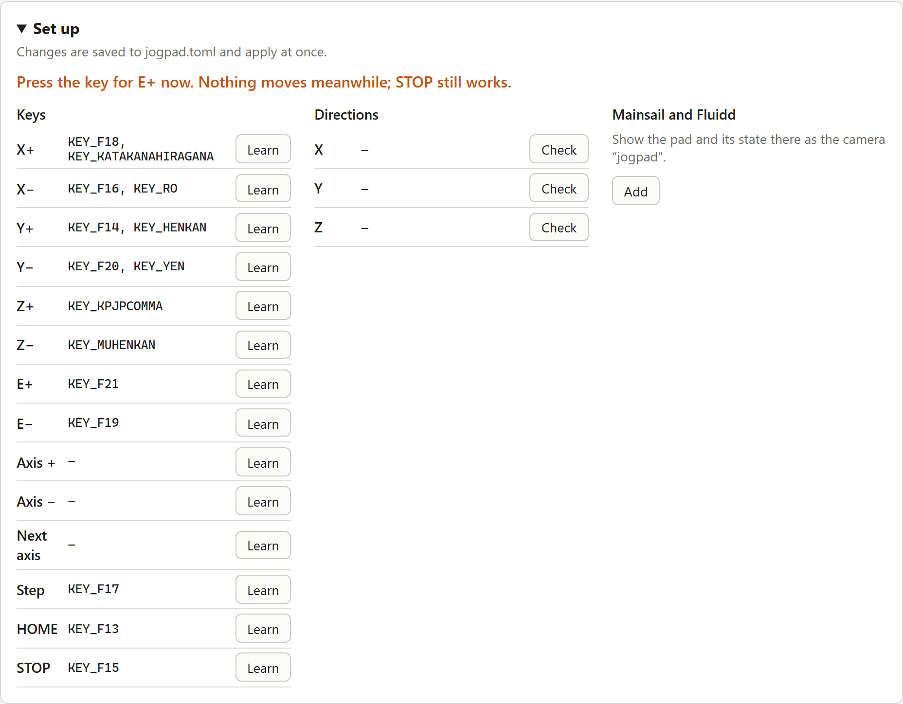
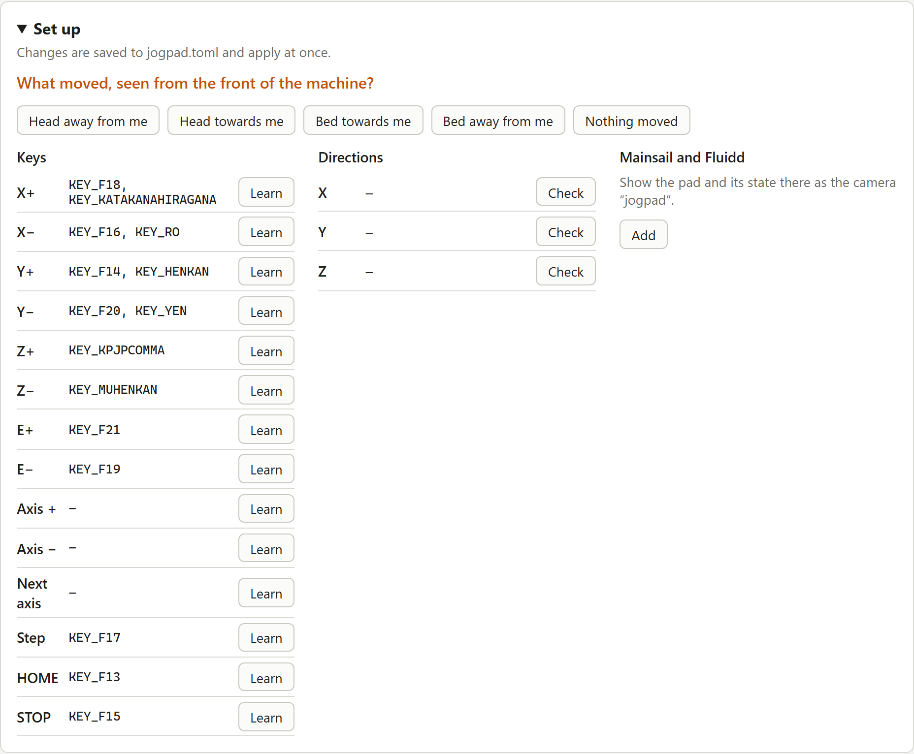
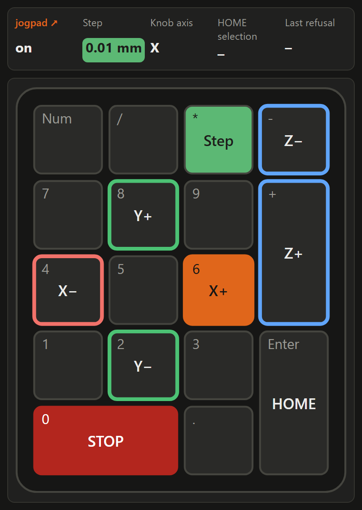

# Klipper setup

jogpad talks to Klipper through Moonraker. It runs on the same computer, usually
the Raspberry Pi, and reads the pad from `/dev/input`.

## Requirements

- Linux with Python 3.10 or newer; where the system's is older, the
  [installer](installation.md#older-systems-with-python-37-or-39) downloads one
- Klipper with Moonraker, and `[respond]` in `printer.cfg` so jogpad's messages
  appear in the Mainsail or Fluidd console
- A USB numeric keypad, or a macro pad programmed to send distinct keys

## 1. Find the pad

```bash
jogpad devices
```

Pick the entries for your pad. Pads often show up as two devices (keys and
media keys); add both if your knobs send volume keys. Use the
`/dev/input/by-id/...` path, it survives replugging.

The user running jogpad must be allowed to read input devices:

```bash
sudo usermod -aG input $USER    # log out and in again
```

### Program a CH57x macro pad

Out of the box a CH57x macro pad types letters and digits. jogpad writes other
codes into it, the ones its drawing `ch57x-9k3` expects: F13 to F24 for the
nine keys and the three knob presses, International1 to 6 for turning the
knobs. No program on a printer host reacts to those keys.

```bash
jogpad program-pad
```

It finds a pad with USB ID 1189:8840 or 1189:8842 by itself and lists each
key with its new code. `--dry-run` shows what it would write, without writing.
The pad keeps the codes when unplugged. Afterwards jogpad reads them back from
the pad and writes any that did not arrive once more. If one is still missing,
it names it: unplug the pad, plug it in again and run `jogpad program-pad`
once more. Should a pad not answer the read-back, jogpad says so; then press
every key and turn every knob on the [web page](#web-page) or with
`jogpad keys`.
The installer allows the group `input` to program the pad. Pads with USB ID
1189:8890 speak another protocol and are not supported yet.

## 2. Write `jogpad.toml`

A numeric keypad works without a `[input.keys]` section:

```toml
[input]
devices = ["/dev/input/by-id/usb-SIGMACHIP_USB_Keyboard-event-kbd"]
```

A CH57x macro pad, programmed with `jogpad program-pad`, needs no
`[input.keys]` either; its layout brings its own defaults:

```toml
[input]
devices = ["/dev/input/by-id/usb-1189_..."]   # the path jogpad devices shows
layout = "ch57x-9k3"
```

```text
Keys                  Knobs, turned right / left
HOME   Y+     STOP    A  small, top      X+ / X−
X−     Step   X+      B  small, middle   Y+ / Y−
E−     Y−     E+      C  big, bottom     Z+ / Z−
```

The keys around the middle one form a cross for X and Y; the big knob is Z,
the axis that needs the finest control. Pressing a knob does nothing: knobs
are easily pressed while turning, and a step that changes unnoticed from
0.01 to 0.1 mm is exactly what jogpad is meant to prevent.

Your keys replace the default of the same action; the others keep their
default. `[]` switches an action off. With the `ch57x-9k3` layout the keypad
defaults are gone, so list the keypad keys too if you use both. All options:
[configuration reference](reference/config.md).

Check what each key sends and which action it triggers, without moving
anything:

```bash
jogpad keys --config jogpad.toml
```

The [web page](#web-page) does the same with a drawing of the pad, and can
assign keys for you.

## 3. Run it

```bash
jogpad check-config jogpad.toml
jogpad serve --config jogpad.toml
```

The installer sets jogpad up as a service that starts with the machine, see
[Installation](installation.md). After editing `jogpad.toml`, restart it from
the service menu in Mainsail or Fluidd, or with `sudo systemctl restart jogpad`.
Stop the service before running `jogpad keys`: it holds the pad exclusively.

## Using it

| Key | What happens |
| --- | --- |
| Axis key or knob detent | moves by one step. Presses during a running move are merged into the next move |
| Axis key held for half a second | keeps moving until released, at the speed that goes with the step size |
| Step | next step size (0.01, 0.1, 1 mm by default) and its speed for held keys; jogpad starts with the smallest |
| Select next | the knob switches to the next axis in `select_axes` |
| HOME | starts the HOME selection: press axis keys to pick axes, HOME again to home. Twice HOME homes all axes. Any other key, or 5 s without input, cancels |
| STOP | sends Klipper's emergency stop immediately, even during a move. Not a safety device, see [Safety](safety.md) |

A short press moves one step. Hold an axis key for half a second, and its axis
keeps moving until you let go, at the speed that goes with the step size:

| Step | X, Y | Z | Extruder |
| --- | --- | --- | --- |
| 0.01 mm | 2 mm/s | 0.5 mm/s | 1 mm/s |
| 0.1 mm | 10 mm/s | 2 mm/s | 2 mm/s |
| 1 mm | 50 mm/s | 10 mm/s | 5 mm/s |

The axis runs on for up to 0.65 s after you let go, since Klipper cannot take
back a move it has queued: up to 33 mm at 50 mm/s, see
[Safety](safety.md#holding-a-key). jogpad keeps it that short by queueing a
short move four times a second, and Klipper slows down briefly between them, so
the axis pulses a little. Any other key ends the move. Knobs always move in
steps. Under `[jog]`, `hold_speeds_xy`, `hold_speeds_z` and
`hold_speeds_e` set the speeds, one per step size and at most 250 mm/s;
`hold_delay` sets the half second.

Every move and every homing shows up in the Mainsail or Fluidd console, for
example `jogpad X +0.3 mm`, so others at the machine can see who moved it. Merged
presses give one line, and so does a held key when you let go. Set
`announce_moves = false` under `[jog]` to turn this off.

## Without looking

jogpad is built so that your eyes can stay on the nozzle, and it tells you
what it does through the pad and the printer:

- **Feel**: the keys sit where your finger left them, and every knob detent is
  one step. On the CH57x pad the middle key is the step key, the keys around
  it form a cross for X and Y, and STOP is the top right corner.
- **See**: a CH57x pad lights up green, yellow or red for the step size.
- **Hear**: the printer's beeper counts the step size, once for the smallest
  step, and plays a sound of its own when a key is refused. Both are off until
  you set them, see [the step beep](#web-page) and
  [hear a refusal](#hear-a-refusal).

A setup with both sounds, for a printer with an `M300` macro:

```toml
[sounds]
step = "M300 S1000 P100"
refusal = "M300 S440 P600"
```

The HOME selection and the reason for a refusal still show only in the console
and on the web page. No one with low vision has tested jogpad yet. If you have,
please [open an issue](https://github.com/Aitch-ko/jogpad/issues) and tell us
what is missing.

## Web page

`jogpad serve` also serves a page on port 7150 of the machine, for example
`http://printer.local:7150/`. It draws your
pad and lights up every key you press, with the action it triggers, and shows
step size, knob axis and the last refusal. Keys outside the drawing are listed
too, so the page also tells you which code an unknown key sends.

Symbols and colours help to find your way. They follow the action of each
key, so a key you learn or set gets its symbol by itself:

- X and Y keys carry a thick arrow pointing the way the tool goes, with the
  action written in it; Y+ points up, away from you.
- Z and extruder keys carry a large plus or minus sign with the axis in it.
- HOME shows a house.
- X is red, Y green, Z blue, as in slicers, and the extruder amber.
- STOP is red. The step size and the step key are green for the smallest
  step, red for the largest and yellow for those between, so a large step is
  seen before it moves the machine.

An arrow over each knob, in the colour of its axis, shows what turning it
does: the label at its left end belongs to turning left, the one at its right
end to turning right, for example `X−` and `X+`. The labels follow the keys
you set, and a knob on `selected_plus` and `selected_minus` names and colours
the selected axis. With every detent the knob and the end of the arrow light
up.

A CH57x macro pad shows the step size itself: with a CH57x layout jogpad lights
the whole pad in the same colours, green after every start. The pad stores each
new colour in its flash memory, which takes only so many writes, so jogpad
writes only when the colour changes. `step_light = false` under `[input]`
leaves the pad's light alone.

To know the step size without looking, let the printer beep it: once for the
smallest step, twice for the next, and so on. Give `step` under `[sounds]`
the G-code for one beep, for example with an `M300` macro for the beeper in
`printer.cfg`:

```toml
[sounds]
step = "M300 S1000 P100"
```

Klipper has no `M300` of its own. Where `printer.cfg` has none, switch the
beeper's pin directly. On a QIDI Plus 4 it is the output pin `buzzer`:

```toml
[sounds]
step = "SET_PIN PIN=buzzer VALUE=1\nG4 P100\nSET_PIN PIN=buzzer VALUE=0"
```

Without a beeper, or with `step` left empty, jogpad does not beep.

Pick the drawing with `layout` under `[input]`: `numpad` (default),
`ch57x-9k3`, or `none` for the list only.

The `ch57x-9k3` drawing expects the codes `jogpad program-pad` writes into the
pad, see [Program a CH57x macro pad](#program-a-ch57x-macro-pad): F13 to F24
for the nine keys and the three knob presses, and the Japanese keys `KEY_RO`,
`KEY_KATAKANAHIRAGANA`, `KEY_YEN`, `KEY_HENKAN`, `KEY_MUHENKAN` and
`KEY_KPJPCOMMA` (International1 to 6 in USB terms) for turning the knobs left
and right. The drawing follows a pad with USB ID 1189:8840: nine keys on the
left, two small knobs and a big one on the right.

The page speaks English and German. It follows your browser's language; the
menu at the top switches it, and your browser remembers the choice. The menu
next to it switches between light and dark; `Auto` follows your browser's
setting. Messages in
the Mainsail or Fluidd console stay in the configured `language`, since
everyone at the machine reads them.

At the bottom, next to its version, the page links to the repository, to a
bug report form with your jogpad version already filled in, and to the release
notes.


### Set up keys and directions

Under **Set up**, folded away until you click it, the page changes
`jogpad.toml` for you; the running service takes the change over at once.
Comments in the file are kept.

- **Learn**: click it next to an action, then press the key on the pad. For
  30 seconds keys only show up on the page and move nothing; STOP still works.
  If the key already belongs to another action, the page asks before moving it.
- **Check** a direction: press the + key of that axis on the pad. The machine
  moves. Then pick what you saw from the front of the machine, for example
  "head away from me" or "bed towards me". If it went the wrong way, jogpad
  reverses that axis (`invert` under `[jog]`). Reversing changes only which
  way the keys move, not Klipper's coordinates.





The page itself never moves the machine; moves only come from the pad.

### Who may change what

Every computer in your network can open the page and watch the key presses;
there is no login. Changes, such as learning keys or checking directions, are
allowed from the machine itself and from the computers Moonraker trusts: the
addresses and ranges under `trusted_clients` in `moonraker.conf`. Whoever may
move the machine from Mainsail or Fluidd may also change what the keys do.
jogpad asks Moonraker on every change, so an edited `moonraker.conf` counts as
soon as Moonraker has restarted.

Host names in `trusted_clients` do not count for jogpad, only addresses and
ranges. With `force_logins` in Moonraker, only the machine itself may change
anything.

To keep the page on the machine itself, set `host = "127.0.0.1"` under
`[server]` and open it through an SSH tunnel:

```bash
ssh -N -L 7150:127.0.0.1:7150 pi@printer.local
```

and then `http://127.0.0.1:7150/` on your computer. `allow_remote_changes =
true` lets every computer in the network reassign your keys, STOP included.

### Show the pad in Mainsail and Fluidd

Mainsail and Fluidd have no panels for other programs, but both show a web
page as a camera. Under **Set up**, **Add** registers jogpad's compact view,
the pad and its state, as the camera `jogpad` in Moonraker; both show it in
their camera panel. **Remove** takes it out again. **jogpad ↗** at the top left
of the view opens the full page in a new tab.

The camera's aspect ratio follows the drawing of your pad. After a change of
`layout`, jogpad sets the new one when it starts; the journal says so.



Open the page with the printer's address when you add it, for example
`http://printer.local:7150/`: Mainsail and Fluidd load the view from that
address, so `127.0.0.1` through a tunnel is refused. The view is light or
dark as chosen on the page under the same address, otherwise as your browser
is set; the theme of Mainsail does not count. If you
reach Mainsail over HTTPS, the browser blocks the view, since jogpad serves
plain HTTP. The compact view is also at `http://printer.local:7150/?view=panel`.

## Switch it on and off in Mainsail or Fluidd

A switch in Mainsail and Fluidd turns jogpad off while you do not need it.
Off means every key does nothing, STOP included, and nothing appears in the
console. After a Klipper restart jogpad is on again.

The installer asks whether to set the switch up. Later, run:

```bash
jogpad setup-switch
```

It writes the macro `_JOGPAD` to `~/printer_data/config/jogpad.cfg`, adds
`[include jogpad.cfg]` to `printer.cfg` above the `SAVE_CONFIG` block and

```ini
[power jogpad]
type: klipper_device
object_name: gcode_macro _JOGPAD
```

to the end of `moonraker.conf`. Before changing a file it keeps a copy next
to it, such as `printer.cfg.bak-20261025-143000`. Entries that are already
there stay as they are, so running it again only refreshes the macro; the
installer does that every time it runs. `--config-dir` points it at another
folder.

After restarting Klipper and Moonraker, `jogpad` shows up among the power
devices in Mainsail and Fluidd; in Mainsail that is the power menu at the top
right. The field `jogpad` on the web page and in the
[camera panel](#show-the-pad-in-mainsail-and-fluidd) switches as well, from
the computers that may change settings. While jogpad is off, the pad there is
greyed out under a note with a button to switch it on again.

The include alone is enough for the switch on the web page and in the panel;
`[power jogpad]` adds the one in the power menu. Without the macro there is
no switch, and jogpad is always on. If jogpad cannot read the switch, it
refuses to move, but STOP still goes out.

## Locks

By default jogpad refuses to move or home while a print is running or paused.
Add your own conditions, for example for a laser or a spindle:

```toml
[[machine.locks]]
object = "print_stats"
field = "state"
equals = ["printing", "paused"]
reason = "job running"

[[machine.locks]]
object = "gcode_macro LASER_VARS"
field = "laser_on"
reason = "laser on"
```

Without `equals`, a lock applies when the field is true or non-zero. When the
status cannot be read, jogpad refuses as well, and so it does when a lock's
object or field does not exist: Klipper reports those as null, and a typo in
the name of a laser lock must not switch it off unnoticed. The refusal names
the lock, so check the console after adding one. Defining `[[machine.locks]]`
replaces the default list, so repeat the print lock if you want to keep it.

### Hear a refusal

A refused key moves nothing, and the reason shows only in the console and on
the web page. To hear it, give `refusal` under `[sounds]` the G-code for
a sound that differs from the step beeps, such as one long, low beep:

```toml
[sounds]
refusal = "M300 S440 P600"
```

jogpad sends it when a lock or the switch in Mainsail or Fluidd holds a key
back, when the status cannot be read, and when Klipper refuses a move or
homing, for example "Must home axis first". Empty, the default, stays silent.
